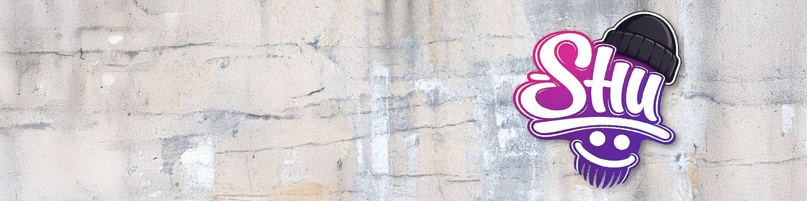

### I Build The Stuff I Want To Play With, Then Give It Away.

Retro Gaming Builds, Game Mods And Free Tools For PC And Steam Deck. Everything Here Is Free, Built By Shu With .

| Project | What It Does |
|---|---|
| [Shu's LaunchBox 4K CRT Build](https://github.com/shu2600/shus-launchbox-4k-crt-build) | A Setup Wizard That Puts Every System On Its Own Period TV, Real Arcade Cabinets Round MAME, Covers And Manuals Filled In |
| [Shu's Steam Deck CRT Build](https://github.com/shu2600/shus-steam-deck-crt-build) | Sends Your LaunchBox Library To EmuDeck With The Same Looks |
| [Shu's DLSS 5 Switch](https://github.com/shu2600/shus-dlss5-switch) | Turns DLSS 5 On And Off In Your Own Games, Clean And Reversible |

**Like What I Make?** [Support Me On Patreon](https://www.patreon.com/cw/Shu2600)

[shuhq.com](https://shuhq.com) &nbsp;·&nbsp; [X](https://x.com/ShuHQcom) &nbsp;·&nbsp; [YouTube](https://www.youtube.com/@shudoggy666) &nbsp;·&nbsp; [Discord](https://discord.gg/8ffsAsjH7q) &nbsp;·&nbsp; [Patreon](https://www.patreon.com/cw/Shu2600)
